# Sodexo Planning

**Le planning de travail de l'équipe, dans la poche, sur Android.**

Sodexo Planning remplace la feuille de planning papier : on recopie une fois par mois le planning de toute l'équipe (qui travaille quel jour, sur quel poste), et chacun retrouve ensuite ses jours, ses horaires et ses collègues du jour en un coup d'œil. L'app synchronise son planning avec l'agenda du téléphone, rappelle la veille de chaque jour travaillé, et calcule les collations à préparer. Tout reste sur le téléphone.

  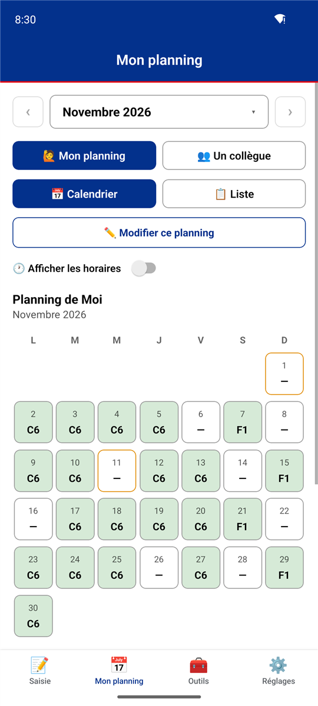
  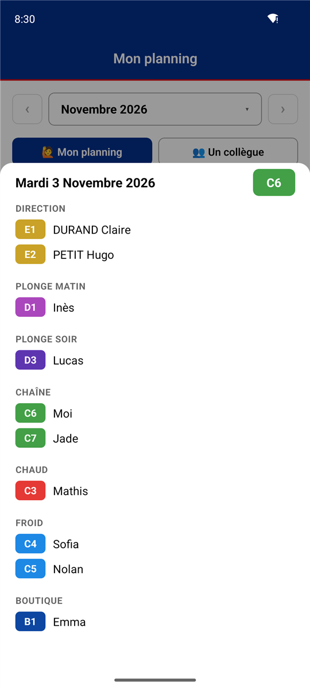
  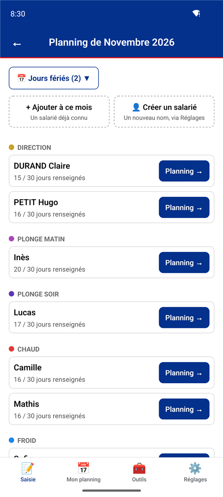

> **Télécharger** : dernière version dans les [Releases GitHub](https://github.com/Forthtilliath/sodexo-planning/releases) (fichier `Sodexo-Planning-<version>.apk`).

## Sommaire

- [Les onglets](#les-onglets)
- [Mon planning](#mon-planning)
- [Le détail d'un jour](#le-détail-dun-jour)
- [Le planning d'un collègue](#le-planning-dun-collègue)
- [Partager et exporter](#partager-et-exporter)
- [Saisir le planning du mois](#saisir-le-planning-du-mois)
- [Collations et petits-déjeuners](#collations-et-petits-déjeuners)
- [Salariés et groupes de postes](#salariés-et-groupes-de-postes)
- [Rappels et notifications](#rappels-et-notifications)
- [Sauvegarde](#sauvegarde)
- [Mises à jour](#mises-à-jour)
- [Apparence](#apparence)
- [Vos données](#vos-données)
- [Installation](#installation)
- [Questions fréquentes](#questions-fréquentes)

## Les onglets

| Onglet | Pour quoi faire |
|---|---|
| 📝 **Saisie** | Créer ou modifier le planning d'un mois (toute l'équipe). |
| 📅 **Mon planning** | Consulter son planning ou celui d'un collègue, l'envoyer dans l'agenda. C'est l'onglet ouvert au lancement. |
| 🧰 **Outils** | Calculer les produits à préparer pour les collations et les petits-déjeuners. |
| ⚙️ **Réglages** | Mon nom, rappels, thème, salariés, groupes de postes, sauvegarde, mises à jour. |

## Mon planning

L'écran s'ouvre sur **le mois en cours**, en **calendrier** :

- chaque jour travaillé affiche son **code de poste** (C6, E1, D3…), coloré selon son groupe ;
- un tiret **—** signale un jour non travaillé ;
- les **jours fériés** ont une bordure orange, **aujourd'hui** est mis en évidence ;
- les flèches **‹ ›** et la liste déroulante passent d'un planning saisi à l'autre ;
- **Modifier ce planning** ouvre directement la saisie de ce mois, sur votre ligne.

 

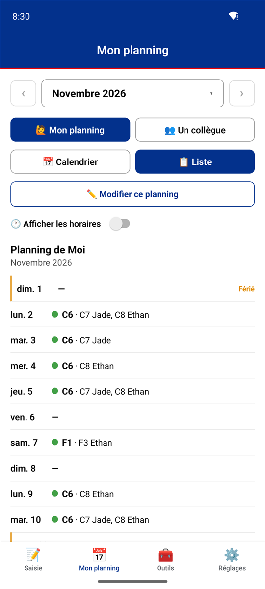

La vue **Liste** déroule le mois jour par jour, avec pour chaque jour travaillé votre poste et **les collègues du même groupe** ce jour-là (« C6 · C7 Jade, C8 Ethan »). Les fériés y sont signalés en toutes lettres.

L'interrupteur **Afficher les horaires** ajoute les heures de début et de fin de chaque poste, quand elles sont connues (voir [groupes de postes](#salariés-et-groupes-de-postes)).

« Votre » ligne est celle qui porte votre nom dans le planning : **Moi** par défaut, ou le nom choisi dans Réglages ▸ Mon nom.

 

## Le détail d'un jour

Un appui sur un jour du calendrier ouvre sa fiche : **tout le monde qui travaille ce jour-là**, regroupé par équipe (Direction, Plonge matin, Plonge soir, Chaîne, Chaud, Froid, Boutique…), chacun avec son code de poste. Pratique pour savoir avec qui on travaille ou à qui demander un échange.

 

## Le planning d'un collègue

  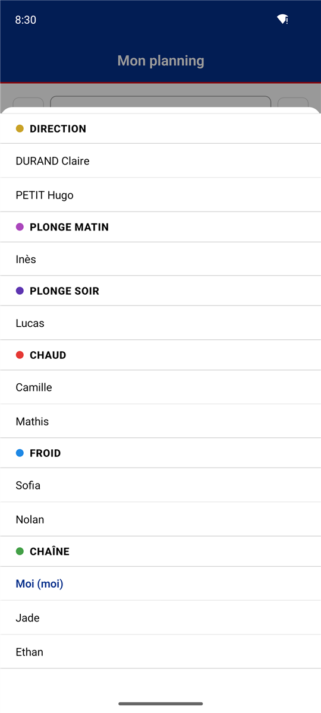
  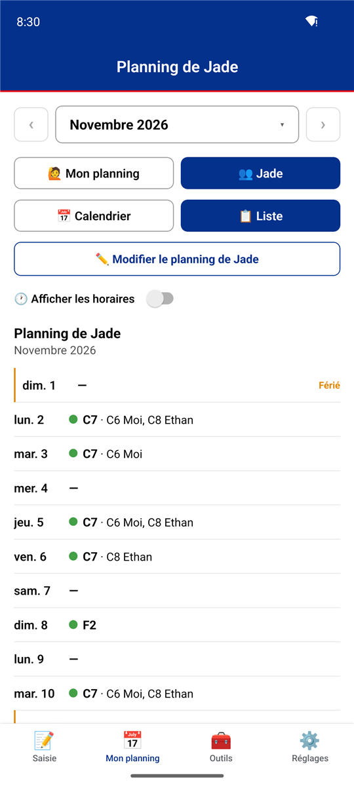

**Un collègue** affiche le planning de n'importe quel salarié, choisi dans une liste regroupée par équipe : mêmes vues calendrier et liste, mêmes détails par jour.

## Partager et exporter

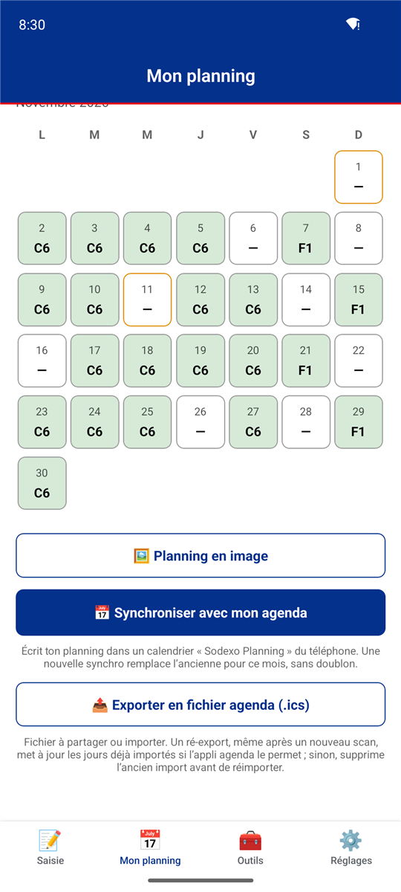

En bas de Mon planning :

- **Planning en image** : le mois affiché, en image, prêt à envoyer dans une conversation.
- **Synchroniser avec mon agenda** : écrit votre planning dans un calendrier **« Sodexo Planning »** créé sur le téléphone, visible dans l'appli Agenda (et masquable d'un geste). Une nouvelle synchro **remplace** celle du mois, sans créer de doublon. Les vrais horaires de chaque poste sont repris quand ils sont connus ; sinon, l'événement dure la journée. L'autorisation d'accès à l'agenda est demandée au premier usage, et ne sert qu'à ce calendrier : vos autres agendas ne sont jamais touchés.
- **Exporter en fichier agenda (.ics)** : un fichier à partager ou à importer dans n'importe quel agenda. Utile pour le planning d'un collègue, ou si vous refusez l'accès à l'agenda. Un ré-export met à jour les jours déjà importés au lieu de les dupliquer (si l'appli agenda le permet).

 

## Saisir le planning du mois

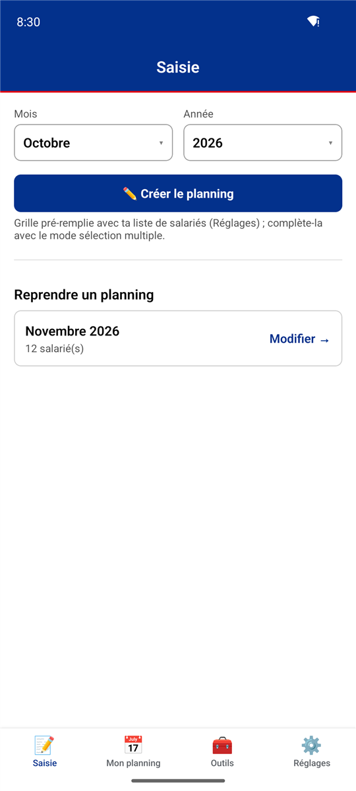

L'onglet **Saisie** :

1. choisir le **mois** et l'**année**, puis **Créer le planning** : la grille est pré-remplie avec la liste des salariés réguliers (voir [Salariés](#salariés-et-groupes-de-postes)) ;
2. ou **Reprendre un planning** déjà créé (nombre de salariés indiqué). Balayer un planning de cette liste vers la gauche révèle **Supprimer** ; une barre **Annuler** permet de revenir sur la suppression pendant quelques secondes.

Tout est **enregistré automatiquement** à chaque modification.

 

  
  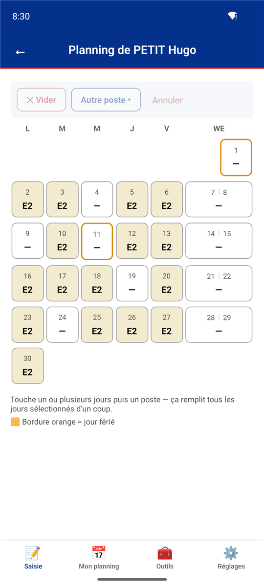
  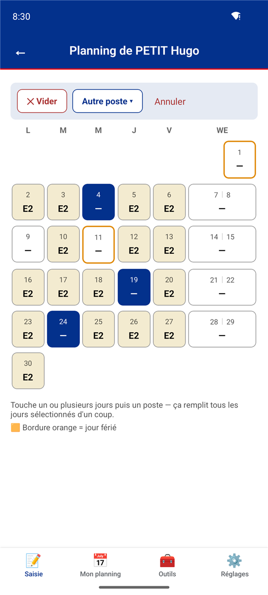

Le planning d'un mois liste les salariés **par équipe**, avec pour chacun le nombre de jours renseignés (« 16 / 30 jours renseignés »). Depuis cet écran :

- **Jours fériés** : se cochent sur une grille du mois (bordure orange partout ensuite) ;
- **Ajouter à ce mois** un salarié déjà connu (un intérimaire, par exemple), ou **Créer un salarié** ;
- **Planning →** ouvre le mois d'un salarié.

Pour remplir le mois d'un salarié, **touchez un ou plusieurs jours** (ils passent en bleu), puis choisissez un poste : tous les jours sélectionnés le prennent d'un coup. Les **codes habituels** du salarié apparaissent comme boutons rapides, colorés selon leur groupe ; **Autre poste** propose tous les codes ; **Vider** remet les jours en repos ; **Annuler** désélectionne. Le samedi et le dimanche sont regroupés dans une colonne **WE**.

  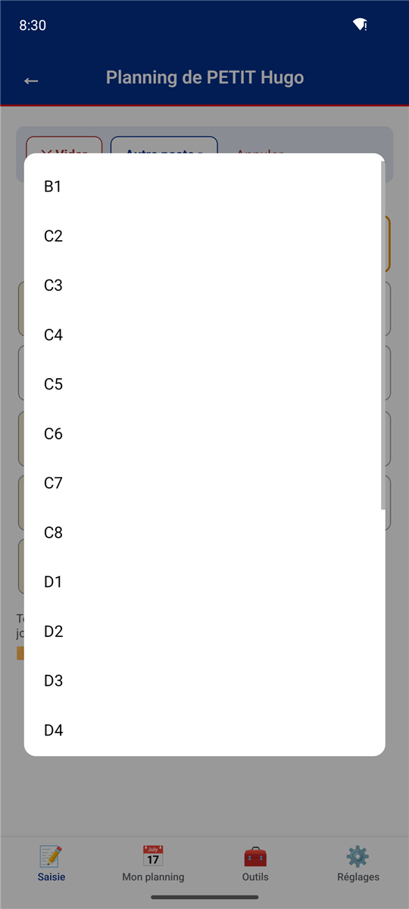

## Collations et petits-déjeuners

  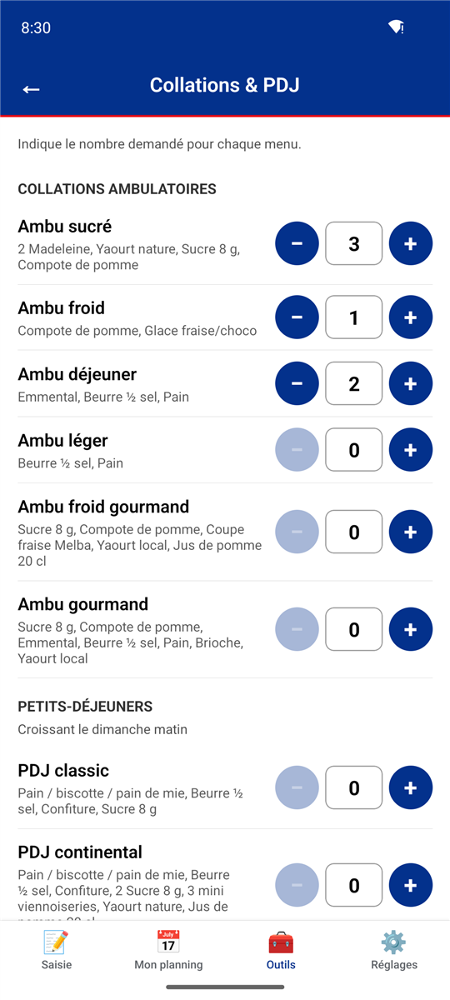
  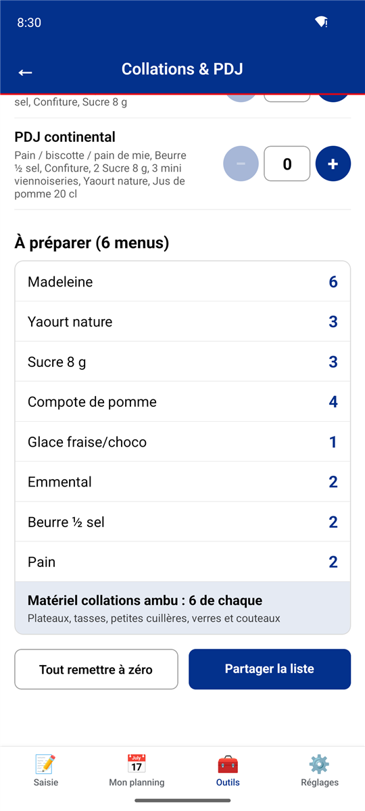

**Outils ▸ Collations & PDJ** : indiquez avec **− / +** le nombre demandé pour chaque menu (collations ambulatoires sucrée, froide, déjeuner, légère ; petits-déjeuners classique et continental…). L'app additionne et affiche **tout ce qu'il faut préparer** (« 6 Madeleine, 3 Yaourt nature… »), plus le matériel des collations ambu. La liste se **partage** en un geste (message, note…).

## Salariés et groupes de postes

  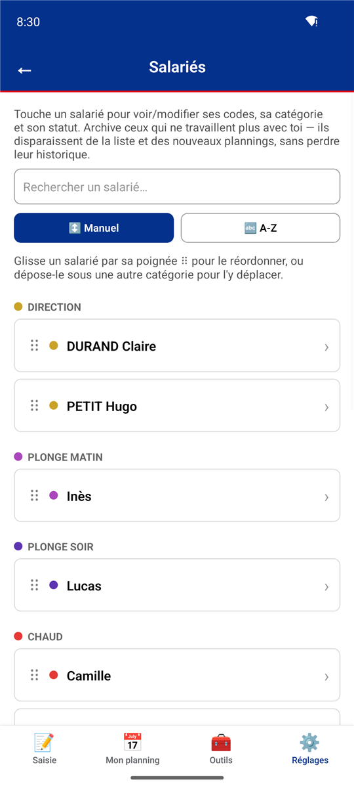
  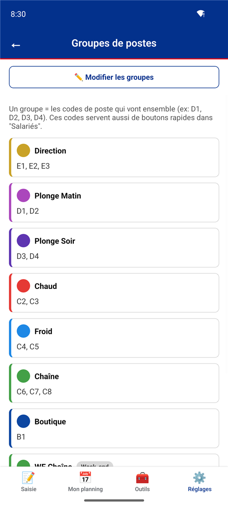
  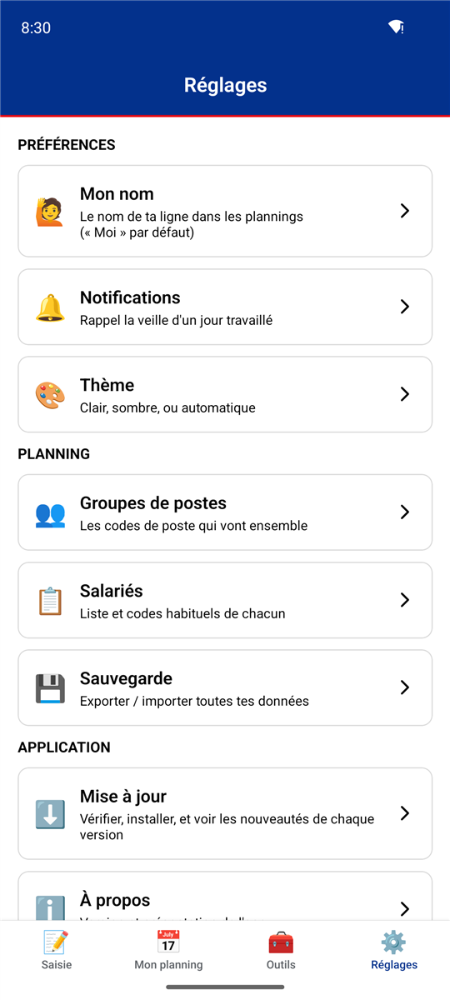

**Réglages ▸ Salariés** : la liste de l'équipe, avec recherche et tri alphabétique ou par poste principal. Chaque salarié s'édite dans une fiche en bas d'écran.

- Chaque salarié a ses **codes habituels** (boutons rapides de la saisie) et une catégorie (son équipe).
- Un salarié **régulier** est ajouté automatiquement à chaque nouveau planning ; un **intérimaire** ne l'est pas (on l'ajoute au mois voulu).
- Un salarié qui part se **désactive** au lieu d'être supprimé, pour garder les anciens plannings lisibles.
- La liste se **réordonne** par glisser-déposer ; **renommer** un salarié met à jour son nom dans tous les plannings déjà enregistrés.
- **Moi** est toujours présent et mis en évidence partout.

**Réglages ▸ Groupes de postes** : les codes qui vont ensemble, avec un nom et une couleur (Direction E1-E3, Plonge matin D1-D2, Plonge soir D3-D4, Chaud C2-C3, Froid C4-C5, Chaîne C6-C8, Boutique B1, et les variantes **week-end / férié** F1-F5). Les groupes se renomment, se réordonnent, changent de couleur ; chaque code peut avoir ses **horaires** (début et fin), repris dans « Afficher les horaires » et dans l'agenda.

## Rappels et notifications

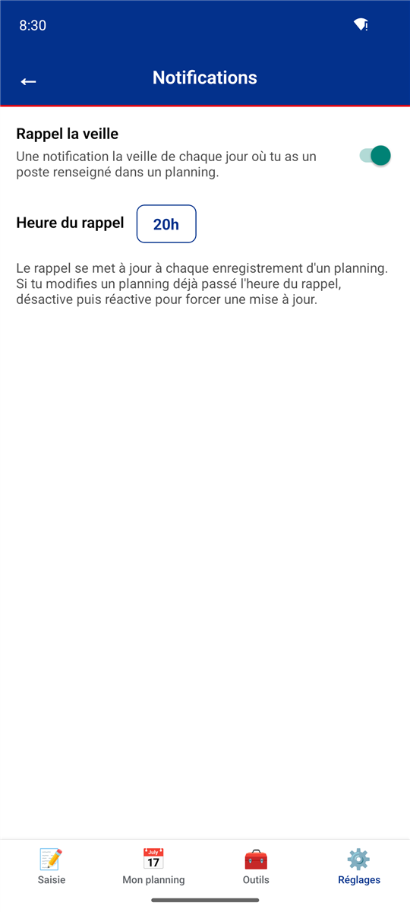

**Réglages ▸ Notifications** :

- **Rappel la veille de chaque jour travaillé**, à l'heure choisie (ex. 20 h) : « Tu travailles demain — Poste : C6 · Avec Jade, Ethan ». Les rappels couvrent les 60 prochains jours et sont recalculés à chaque changement de planning.
- **Rappel de sauvegarde** : une notification tous les 14 jours pour penser à exporter ses données.

Android demande l'autorisation d'afficher des notifications au premier usage.

 

## Sauvegarde

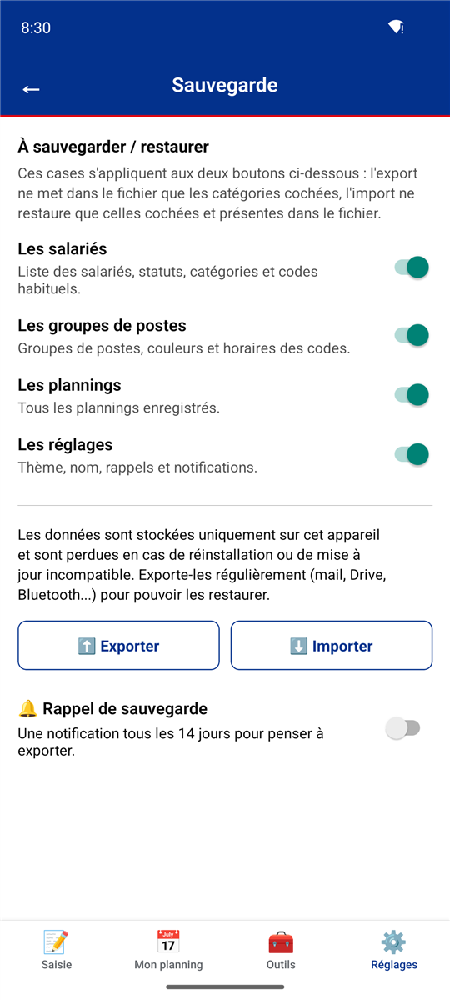

Les données ne sont stockées que sur le téléphone : **désinstaller l'app les efface**. **Réglages ▸ Sauvegarde** :

- **Exporter** crée un fichier (JSON) à envoyer où vous voulez : mail, Drive, Bluetooth…
- **Importer** restaure un fichier exporté. Les catégories cochées (salariés, groupes de postes, plannings, réglages) **remplacent** les données correspondantes ; les autres ne sont pas touchées.
- Les cases à cocher valent pour les deux boutons : on peut n'exporter ou n'importer que les plannings, par exemple.
- Le fichier importé est **entièrement vérifié** avant d'être appliqué : un fichier abîmé, modifié ou trop volumineux est refusé avec un message clair, **rien n'est importé**.

 

## Mises à jour

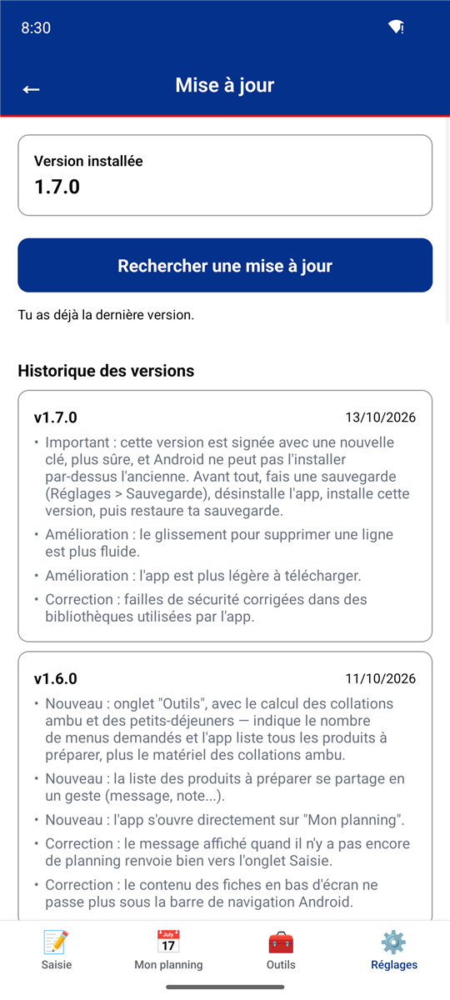

- Au lancement, l'app vérifie s'il existe une nouvelle version et propose de l'**installer directement**.
- **Réglages ▸ Mise à jour** : version installée, vérification manuelle avec barre de progression, et **historique des versions** avec leurs nouveautés.
- Les mises à jour ne viennent que des releases officielles de ce projet, en HTTPS. Le fichier téléchargé est vérifié (empreinte SHA-256) avant installation ; Android demande toujours votre confirmation.

 

## Apparence

  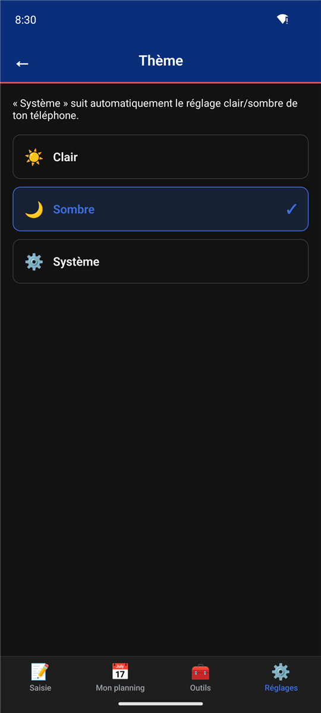
  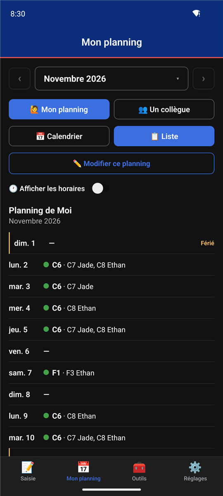

**Réglages ▸ Thème** : clair, sombre, ou **Système** (suit le réglage du téléphone). En-têtes aux couleurs Sodexo, écran de démarrage adapté au thème.

## Vos données

- **Tout reste sur le téléphone**, aucun compte, aucun serveur. Seul ce que vous partagez vous-même quitte l'appareil (fichier de sauvegarde, image, fichier .ics).
- L'accès à l'agenda, s'il est accordé, sert uniquement à écrire dans le calendrier « Sodexo Planning ».
- L'app se connecte à Internet uniquement pour vérifier et télécharger ses mises à jour (GitHub).

## Installation

1. Sur le téléphone Android, ouvrez la [page des Releases](https://github.com/Forthtilliath/sodexo-planning/releases) et téléchargez `Sodexo-Planning-<version>.apk`.
2. Ouvrez le fichier : Android demande une seule fois d'autoriser l'installation depuis le navigateur ou le gestionnaire de fichiers.
3. Les versions suivantes s'installent depuis l'app (Réglages ▸ Mise à jour).

> **Venant d'une version antérieure à 1.7.0** : la 1.7.0 est signée avec une nouvelle clé, et Android refuse de l'installer par-dessus l'ancienne. Exportez une sauvegarde, désinstallez l'app, installez la nouvelle version, puis importez la sauvegarde.

L'app est disponible pour Android uniquement.

## Questions fréquentes

**Mon planning est vide alors que le mois est saisi.** L'app cherche votre ligne sous le nom **Moi** (ou celui de Réglages ▸ Mon nom) : vérifiez que c'est bien ce nom qui figure dans la saisie du mois.

**Je ne reçois pas les rappels.** Vérifiez qu'ils sont activés (Réglages ▸ Notifications) et que les notifications de l'app sont autorisées dans les réglages Android.

**Les événements de l'agenda sont en double.** Une synchro remplace toujours celle du même mois dans le calendrier « Sodexo Planning ». Les doublons viennent d'un fichier .ics importé à côté : supprimez cet import dans l'appli Agenda.

## Développement

Installation de l'environnement, architecture, tests, signature et publication : voir le [README développeurs](docs/README.md).
